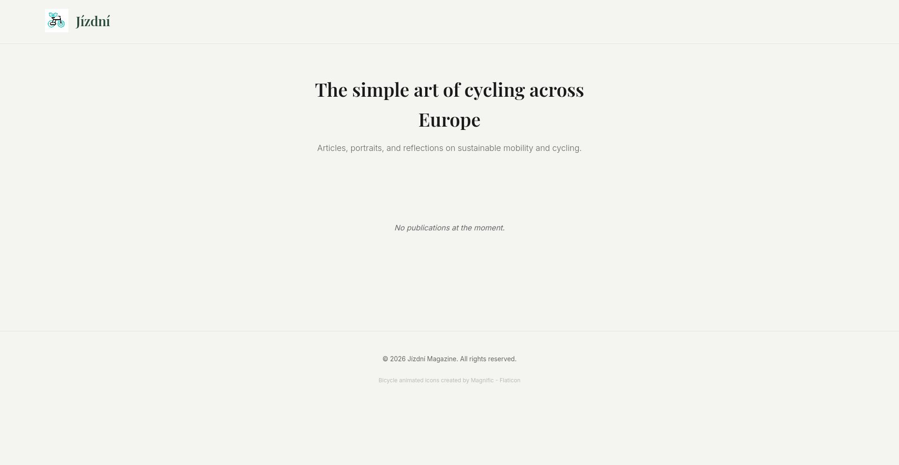
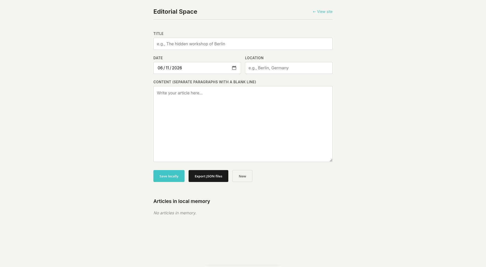

# Jízdní | European Cycling Mechanics & Culture 

A minimalist (amateur) editorial website.
Todo : Insert picture inside articles, making this with editor.html

## 📂 Project Structure

```text
.
├── start.sh              # Run this script to start the server and open the browser (python3)
├── index.html            # Homepage (displays the list of articles)
├── article.html          # Dedicated page for reading a single article
├── editor.html           # Article editor (no visible link, access via URL)
├── update_manifest.py    # Python script that auto-generates the article index
├── src/                  # Static assets folder
│   ├── logo.gif          # Animated site logo
│   └── favicon.png       # Browser tab icon
└── publish/              # Article database folder
    ├── manifest.json     # Index of all articles (auto-generated by the Python script)
    └── article-*.json    # Individual article files (one per article)
```

## Preview



